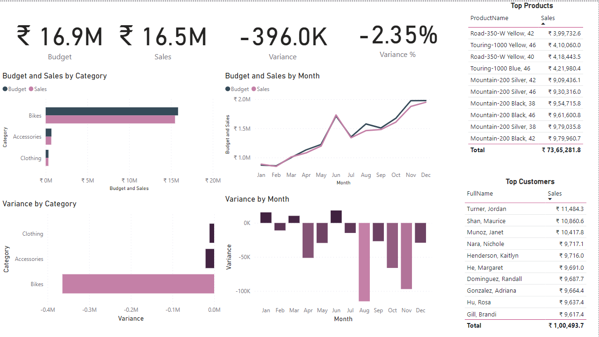
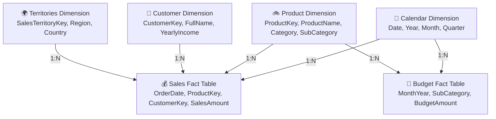

# AdventureWorks Sales & Budget Performance Analytics (Power BI)

[](https://powerbi.microsoft.com/)
[](https://learn.microsoft.com/en-us/dax/)
[](https://office.com/)
[](https://python.org/)
[](LICENSE)

Owned and maintained by **Ayush Mittal**, this Power BI project analyzes AdventureWorks-labeled retail sample data against monthly budgets across product lines, territories, and customer segments.

This repository contains the Power BI report, supporting Excel workbooks, and analysis documentation. The workbooks contain sample sales, budget, and customer records, not a private customer dataset.

---

## 📊 Dashboard Overview



---

## 🎯 Executive Summary & Core KPIs (FY 2016)

During the evaluated fiscal period (2016), realized gross revenue reached **₹ 16.47M** against a budgeted benchmark of **₹ 16.87M**, resulting in an overall negative variance of **-₹ 395.96K (-2.35%)**.

| Metric | Target (Budget) | Realized (Sales) | Absolute Variance | Variance % | Status |
| :--- | :---: | :---: | :---: | :---: | :---: |
| **Total Revenue** | **₹ 16,869,574.00** | **₹ 16,473,618.05** | **-₹ 395,955.95** | **-2.35%** | ⚠️ Slight Deficit |
| **Bikes** | ₹ 15,848,226.00 | ₹ 15,483,926.11 | -₹ 364,299.89 | -2.30% | ⚠️ Primary Volume Driver |
| **Accessories** | ₹ 687,607.00 | ₹ 667,015.32 | -₹ 20,591.68 | -2.99% | ⚠️ Moderate Deficit |
| **Clothing** | ₹ 333,741.00 | ₹ 322,676.62 | -₹ 11,064.38 | -3.32% | ⚠️ Percentage Lag |

---

## 🔍 Key Business Insights

1. **Revenue Concentration in Bikes Category**:
   - Bikes account for **94.0% of total revenue** (₹15.48M of ₹16.47M). While this constitutes the core revenue engine of the business, it also contributed **92.0% of total budget deficit** (-₹364.3K).
2. **Top Selling Products**:
   - The top 5 revenue-generating items are high-end mountain bikes:
     - `Mountain-200 Black, 42` (₹ 9.80 Lakhs)
     - `Mountain-200 Silver, 38` (₹ 9.79 Lakhs)
     - `Mountain-200 Black, 46` (₹ 9.62 Lakhs)
     - `Mountain-200 Black, 38` (₹ 9.55 Lakhs)
     - `Mountain-200 Silver, 46` (₹ 9.30 Lakhs)
3. **Monthly Seasonality & Second-Half Deficit**:
   - Early Q1 and Q2 achieved or surpassed target quotas, peaking in **June** (over ₹1.7M sales).
   - Significant underperformance occurred in **August, October, and November**, where sales dipped significantly below aggressive growth projections, driving the overall deficit for the fiscal year.
4. **Customer Analysis**:
   - Customer-level purchasing patterns can be explored in the report. The EDA script identifies customer records by key rather than printing names.

---

## 🛠️ Data Architecture & Star Schema

The data model follows an optimized **Star Schema** architecture within Power BI's VertiPaq tabular engine, linking multiple dimension tables to central sales transactions and monthly budget targets.



See the complete [Data Dictionary](docs/data_dictionary.md) for full column descriptions and key constraints.

---

## 📐 Core DAX Measures

All calculations are encapsulated in explicit DAX measures:

```dax
// 1. Total Realized Sales Revenue
Sales = SUM(Sales[SalesAmount])

// 2. Aggregated Budget Quota
Budget = SUM(Budget[Budget])

// 3. Absolute Variance (Sales vs Budget)
Variance = [Sales] - [Budget]

// 4. Percentage Variance
Variance % = DIVIDE([Variance], [Budget], 0)
```

See [docs/dax_measures.md](docs/dax_measures.md) for measure hierarchy and formatting settings.

---

## 🖥️ Repository Structure

```text
├── assets/
│   └── dashboard_preview.png      # High-resolution dashboard screenshot
├── docs/
│   ├── data_dictionary.md         # Schema & entity-relationship specifications
│   └── dax_measures.md            # DAX calculations reference & definitions
├── scripts/
│   └── eda_sales_budget.py        # Automated Python data audit and KPI validator
├── Budget.xlsx                    # Monthly category budget allocations
├── Sales.xlsx                     # AdventureWorks relational dataset (Calendar, Customers, Products, Sales, Territories)
├── Data Visualization.pbix        # Interactive Power BI Desktop report
├── .gitignore                     # Git ignore rules for Office and Power BI
├── LICENSE                        # MIT License
└── README.md                      # Executive documentation
```

---

## 🚀 Getting Started

### 1. Requirements
* [Microsoft Power BI Desktop](https://powerbi.microsoft.com/desktop/) (July 2023 or newer recommended).
* Python 3.10+ with `pandas` and `openpyxl` (optional, for running the EDA verification script).

### 2. Opening the Power BI Dashboard
1. Clone this repository:
   ```bash
   git clone https://github.com/ayushmittal67890-dotcom/Sales-Data-Visualization-PowerBI.git
   cd Sales-Data-Visualization-PowerBI
   ```
2. Double-click [`Data Visualization.pbix`](Data%20Visualization.pbix) to launch the report directly in Power BI Desktop.
3. If prompt for data source paths appears, point the Power Query parameters to the local copies of [`Sales.xlsx`](Sales.xlsx) and [`Budget.xlsx`](Budget.xlsx).

### 3. Running the Python EDA Script
To verify the data model metrics independently from command line:
```bash
python scripts/eda_sales_budget.py
```

---

## Project Owner and Maintainer

**Ayush Mittal:** [@ayushmittal67890-dotcom](https://github.com/ayushmittal67890-dotcom)
**Data:** AdventureWorks-labeled sample workbook and the included sales budget workbook. Customer fields are included as report data; avoid treating them as real customer records.

---

## 📄 License

This project is licensed under the [MIT License](LICENSE) - see the [LICENSE](LICENSE) file for details.
