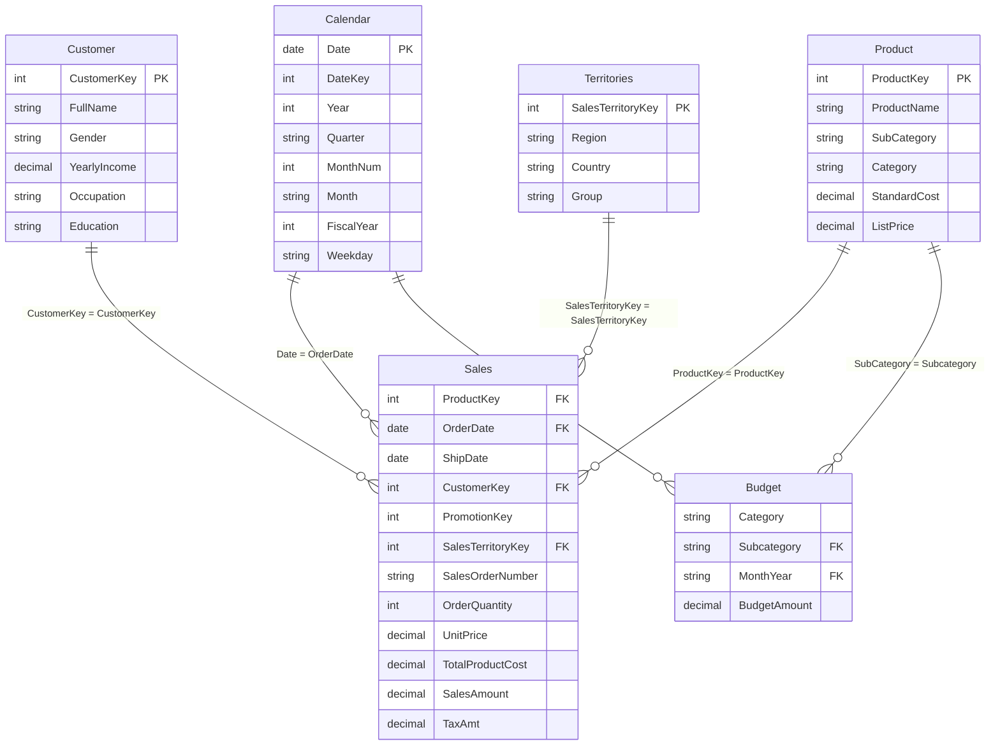

# Data Dictionary - AdventureWorks Sales & Budget Model

This document outlines the entity-relationship schema, table definitions, and data types used in the **Sales vs. Budget** Power BI project.

---

## 1. Schema Overview

The analytical model follows a **Star Schema** architecture optimized for Power BI VertiPaq engine:

---

## 2. Table Specifications

### A. Sales (Fact Table - `Sheet5`)
Contains transaction-level records of all fulfilled orders.
- **`ProductKey`** (Integer, FK): Foreign key referencing the `Product` dimension.
- **`OrderDate`** (Date, FK): Transaction date referencing the `Calendar` dimension.
- **`ShipDate`** (Date): Shipment dispatch date.
- **`CustomerKey`** (Integer, FK): Foreign key referencing the `Customer` dimension.
- **`PromotionKey`** (Integer): Promotional campaign identifier.
- **`SalesTerritoryKey`** (Integer, FK): Foreign key referencing `Territories`.
- **`SalesOrderNumber`** (String): Unique transaction order identifier.
- **`SalesOrderLineNumber`** (Integer): Line item position within order.
- **`OrderQuantity`** (Integer): Units purchased.
- **`UnitPrice`** (Decimal): Price per unit.
- **`TotalProductCost`** (Decimal): Standard production/procurement cost.
- **`SalesAmount`** (Decimal): Net realized sales revenue.
- **`TaxAmt`** (Decimal): Applicable transaction tax.

### B. Budget (Fact Table - `Budget.xlsx`)
Contains target budgets established at the product subcategory and monthly level.
- **`Category`** (String): High-level category (`Accessories`, `Bikes`, `Clothing`).
- **`Subcategory`** (String, FK): Granular product subcategory (e.g., `Helmets`, `Mountain Bikes`).
- **`MonthYear`** (String, FK): Month and year identifier for monthly alignment with `Calendar`.
- **`Budget`** (Decimal): Monthly sales revenue quota/budget in INR (₹).

### C. Calendar (Dimension Table - `Sheet2`)
Comprehensive continuous date dimension table spanning four calendar years.
- **`Date`** (Date, PK): Primary key date value.
- **`DateKey`** (Integer): Surrogate integer key (YYYYMMDD).
- **`Year`** (Integer): Calendar year (e.g., 2016).
- **`Quarter`** (String): Calendar quarter (Q1, Q2, Q3, Q4).
- **`MonthNum`** (Integer): Numeric month index (1–12).
- **`Month`** (String): Short month name (`Jan`, `Feb`, ..., `Dec`).
- **`FiscalYear`** / **`FiscalQuarter`**: Financial reporting periods.
- **`Weekday`** / **`WeekdayWeekend`**: Day-of-week classification.

### D. Product (Dimension Table - `Sheet4`)
Comprehensive catalog of all manufactured and merchandised items.
- **`ProductKey`** (Integer, PK): Primary key.
- **`ProductName`** (String): Official model and size designation.
- **`SubCategory`** (String): Product subcategory.
- **`Category`** (String): Top-level classification (`Bikes`, `Accessories`, `Clothing`, `Components`).
- **`StandardCost`** (Decimal): Internal production cost.
- **`ListPrice`** (Decimal): Suggested retail price.
- **`Color`**, **`ModelName`**, **`ProductLine`**: Product attributes.

### E. Customer (Dimension Table - `Sheet3`)
Demographic and contact profiles for registered retail customers.
- **`CustomerKey`** (Integer, PK): Primary customer ID.
- **`FullName`** (String): Combined customer name (`LastName, FirstName`).
- **`Gender`** (String): Gender identity.
- **`YearlyIncome`** (Decimal): Income bracket.
- **`TotalChildren`** / **`NumberChildrenAtHome`** (Integer): Household size.
- **`Education`** / **`Occupation`**: Socioeconomic indicators.

### F. Territories (Dimension Table - `Sheet6`)
Geographic sales distribution regions and reporting groups.
- **`SalesTerritoryKey`** (Integer, PK): Territory identifier.
- **`Region`** (String): Operating territory (e.g., Northwest, Southwest, France, Australia).
- **`Country`** (String): Country of sale.
- **`Group`** (String): Continental business group (North America, Europe, Pacific).
